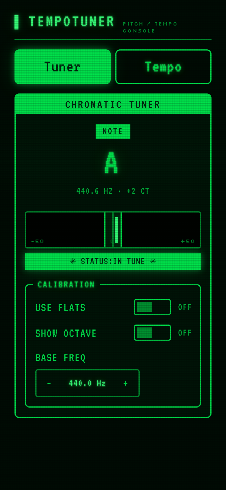
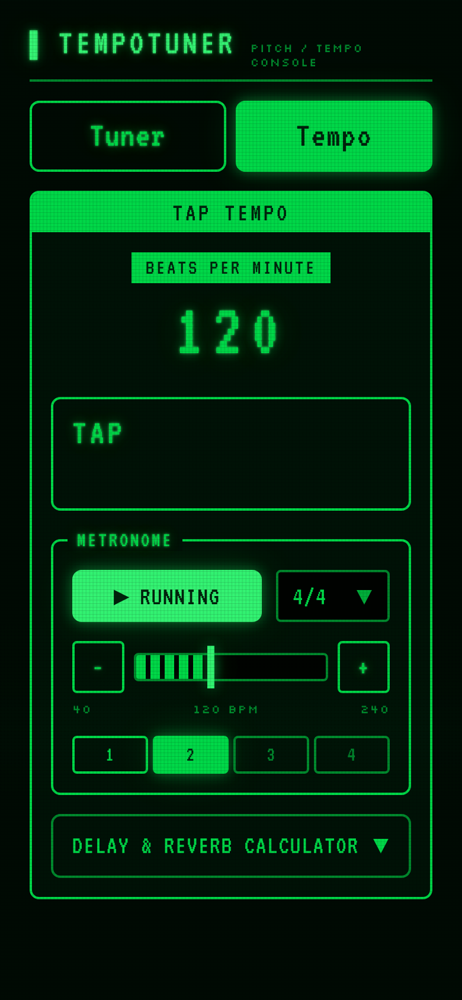
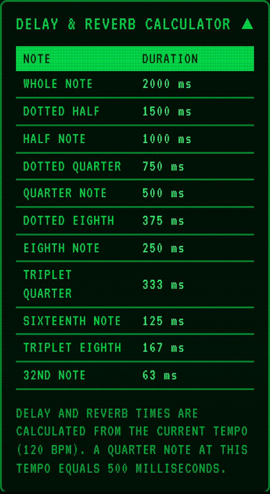

<p align="center">
  
</p>

<h1 align="center">TempoTuner</h1>

<p align="center">
  A chromatic tuner, metronome and tap tempo in the browser, styled as a phosphor-green console.<br>
  <a href="https://tempotuner.fourpixels.workers.dev">tempotuner.fourpixels.workers.dev</a>
</p>

<p align="center">
  
  
  
</p>

## Stack

Astro 7 (static output) with the app as a single React 19 island, TypeScript, Tailwind CSS v4 and Radix UI primitives. Audio is plain Web Audio: an `AnalyserNode` feeding an FFT-based YIN pitch detector, and a look-ahead scheduler for the metronome clicks. Tests run on Vitest with Testing Library.

The visual design adapts [Amber Console](https://github.com/DutchDiederik/AmberConsole) by Diederik (BSD-3-Clause), with the amber swapped for a single green phosphor ramp. Design tokens live in `src/styles/globals.css`.

## Getting started

Requires Node.js 24 (pinned in `.node-version`; Astro needs 22.23.4 or later) and pnpm 10.33 (pinned in `packageManager`, so Corepack picks it up).

```bash
pnpm install
pnpm dev
```

The microphone needs a secure context, so open the dev server on `localhost` rather than a LAN address.

## Scripts

| Script | |
|---|---|
| `pnpm dev` | Dev server |
| `pnpm run check` | Type-check the Astro and TypeScript files (`astro check`) |
| `pnpm lint` | ESLint |
| `pnpm test` | All tests; `test:unit`, `test:integration` and `test:security` run one suite |
| `pnpm build` | Type-check, then build the static site to `dist/` |
| `pnpm run verify` | Lint, test, then build: the check CI and Workers Builds run |
| `pnpm run preview` | Build, then serve `dist/` through the Worker locally with `wrangler dev` (http://localhost:8787) |
| `pnpm run deploy` | Build and deploy from your machine, a fallback to Workers Builds (see [DEPLOY.md](DEPLOY.md)) |

## Deploy

The site is a static-assets-only Cloudflare Worker (`wrangler.jsonc`), live at **https://tempotuner.fourpixels.workers.dev**. Workers Builds is connected to this repository: every merge to `main` runs `pnpm run verify` and then `npx wrangler deploy`. [DEPLOY.md](DEPLOY.md) has the settings, rollback and domain notes.

## Features

- **Chromatic tuner:** real-time pitch detection (YIN) from the microphone, with an adjustable A4 reference, sharps or flats, and an optional octave
- **Tap tempo:** tap the pad or any key to find a song's BPM
- **Metronome:** 40 to 240 BPM in simple, compound and odd time signatures, with a visual beat indicator that shows where the accents fall
- **Delay and reverb calculator:** note durations in milliseconds for the current tempo
- Runs on mobile and desktop and can be installed to the home screen. Everything happens in the browser; no audio leaves the device

On iPhone the metronome asks Safari for a media audio session so the silent switch does not mute it.

## Project layout

```
src/          Astro pages, layout, global styles and sitemap endpoint
components/   Tuner, tap tempo, metronome and UI primitives
hooks/        useTuner
utils/        Pitch detection, FFT, note math, metronome timing
tests/        Unit, integration and security tests (Vitest)
```

## License

Free and open source under the [MIT License](LICENSE).

The theme adapts Amber Console, Copyright (c) 2026 Diederik, under the BSD 3-Clause License; its notice is kept in [`LICENSES/amber-console.BSD-3-Clause.txt`](LICENSES/amber-console.BSD-3-Clause.txt).
